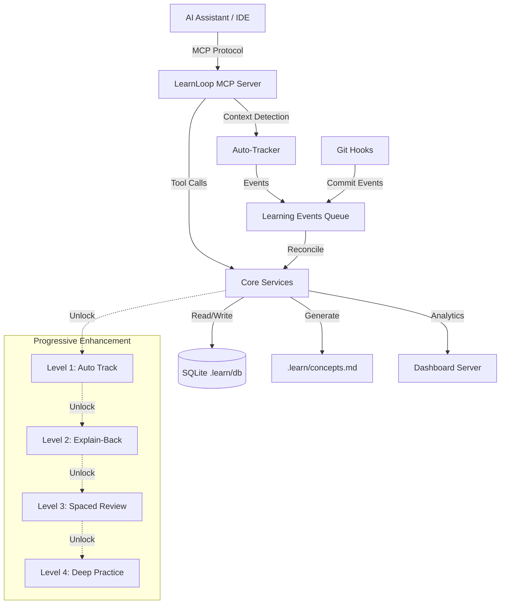
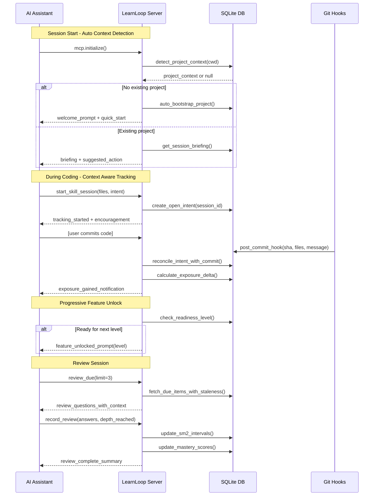

# Design Document: MCP-Native LearnLoop Plugin Redesign

## Overview

Transform LearnLoop from a CLI-based learning companion into an MCP-native plugin with zero-friction setup and progressive enhancement. The redesign maintains core concepts (exposure vs mastery, git verification, spaced repetition) while eliminating adoption barriers through automatic context awareness, one-command installation, and real-time learning loops during AI-assisted coding sessions.

**Key Innovation**: Context-aware auto-tracking that learns from AI assistant conversations without manual configuration, combined with progressive disclosure of advanced features only when users demonstrate readiness.

## Architecture

### High-Level System Architecture



### MCP Integration Flow



## Components and Interfaces

### Component 1: MCP Server Core

**Purpose**: Manages MCP protocol, context detection, and progressive feature unlocking

**Interface**:
```python
class LearnLoopMCPServer:
    def initialize(self, context: MCPContext) -> InitializeResponse:
        """Initialize server with automatic project detection"""
        
    def detect_context(self, workspace_path: Path) -> ProjectContext:
        """Auto-detect project, IDE, and readiness level"""
        
    def register_tools(self) -> list[MCPTool]:
        """Return available tools based on user's readiness level"""
        
    def handle_tool_call(self, tool_name: str, args: dict) -> ToolResponse:
        """Route tool calls to appropriate service handlers"""
```

**Responsibilities**:
- MCP protocol compliance and transport management
- Automatic workspace/project detection from AI context
- Progressive feature visibility based on user level
- Tool routing and response formatting
- Error handling with actionable suggestions

**Key Algorithms with Formal Specifications**:

#### Algorithm: Context Detection & Auto-Bootstrap

```python
def detect_and_bootstrap_context(workspace_path: Path, mcp_context: MCPContext) -> ProjectContext
```

**Preconditions:**
- `workspace_path` is a valid directory path
- `mcp_context` contains assistant conversation state
- LearnLoop database is accessible and initialized

**Postconditions:**
- Returns valid `ProjectContext` with project metadata
- If project doesn't exist, creates new project record
- `.learn/` directory structure exists
- Git hook installed if `.git/` directory present
- User's readiness level calculated and cached

**Algorithm**:
```pascal
ALGORITHM detect_and_bootstrap_context(workspace_path, mcp_context)
INPUT: workspace_path (Path), mcp_context (MCPContext)
OUTPUT: project_context (ProjectContext)

BEGIN
  ASSERT workspace_path.exists() AND workspace_path.is_dir()
  
  // Step 1: Check for existing project
  db_conn ← connect_database()
  existing_project ← query_project_by_path(db_conn, workspace_path)
  
  IF existing_project IS NOT NULL THEN
    // Load existing project context
    project_context ← load_project_context(db_conn, existing_project.id)
    update_last_accessed(db_conn, existing_project.id)
    RETURN project_context
  END IF
  
  // Step 2: Auto-bootstrap new project
  git_root ← detect_git_root(workspace_path)
  project_name ← extract_project_name(workspace_path, git_root)
  
  // Create project record
  project_id ← create_project_record(
    db_conn, 
    name=project_name,
    repo_path=workspace_path,
    detected_at=utc_now()
  )
  
  // Initialize file structure
  learn_dir ← workspace_path / ".learn"
  create_directory(learn_dir / "queue")
  write_file(learn_dir / ".gitignore", "queue/\n")
  initialize_concepts_file(learn_dir / "concepts.md")
  
  // Install git hook if git repo detected
  IF git_root IS NOT NULL THEN
    install_git_hook(git_root, workspace_path)
  END IF
  
  // Detect technologies and frameworks
  technologies ← scan_technologies(workspace_path)
  store_technologies(db_conn, project_id, technologies)
  
  // Initialize readiness tracking
  readiness_level ← calculate_initial_level(db_conn, project_id)
  
  project_context ← create_project_context(
    id=project_id,
    name=project_name,
    path=workspace_path,
    technologies=technologies,
    level=readiness_level,
    is_new=true
  )
  
  RETURN project_context
END
```

**Loop Invariants**: N/A (no loops in main algorithm)

**Error Handling**:
- If database unavailable: Create minimal in-memory context, warn user
- If filesystem write fails: Log error, continue with read-only mode
- If git hook installation fails: Continue without hooks, show manual setup instructions

---

### Component 2: Auto-Tracker Service

**Purpose**: Automatically detects learning opportunities from AI assistant context without manual tool calls

**Interface**:
```python
class AutoTracker:
    def analyze_conversation(self, messages: list[Message]) -> list[LearningEvent]:
        """Extract learning events from AI conversation history"""
        
    def detect_skill_usage(self, code_diff: Diff, context: CodeContext) -> list[SkillTag]:
        """Identify skills used in code changes"""
        
    def infer_intent(self, commit_message: str, files: list[str]) -> IntentMetadata:
        """Extract learning intent from commit metadata"""
        
    def suggest_explanations(self, exposure: ExposureEvent) -> list[ExplanationPrompt]:
        """Generate contextual explanation prompts based on exposure"""
```

**Responsibilities**:
- Parse AI assistant conversation for learning signals
- Detect code patterns and skills from diffs
- Infer learning intent from commit messages
- Generate contextual prompts at optimal moments

**Key Algorithms with Formal Specifications**:

#### Algorithm: Conversation Analysis for Learning Events

```python
def analyze_conversation(messages: list[Message]) -> list[LearningEvent]
```

**Preconditions:**
- `messages` is a non-empty list of conversation messages
- Each message has timestamp, role (user/assistant), and content
- Messages are ordered chronologically

**Postconditions:**
- Returns list of detected learning events with confidence scores
- Each event has type (implementation, decision, explanation, question)
- Events are deduplicated and ranked by relevance
- No false positives for trivial code changes

**Algorithm**:
```pascal
ALGORITHM analyze_conversation(messages)
INPUT: messages (List[Message])
OUTPUT: learning_events (List[LearningEvent])

BEGIN
  ASSERT messages IS NOT EMPTY
  ASSERT is_chronologically_ordered(messages)
  
  learning_events ← empty_list()
  code_segments ← empty_list()
  decision_points ← empty_list()
  
  // Step 1: Extract code segments and decisions
  FOR each message IN messages DO
    IF message.role = "assistant" THEN
      code_blocks ← extract_code_blocks(message.content)
      FOR each block IN code_blocks DO
        IF is_significant_code(block) THEN
          code_segments.add({
            code: block,
            language: detect_language(block),
            timestamp: message.timestamp,
            context: extract_context(message.content, block)
          })
        END IF
      END FOR
      
      decisions ← extract_decisions(message.content)
      FOR each decision IN decisions DO
        decision_points.add({
          decision: decision,
          timestamp: message.timestamp,
          alternatives: extract_alternatives(message.content, decision)
        })
      END FOR
    END IF
  END FOR
  
  // Step 2: Classify and score learning events
  FOR each segment IN code_segments DO
    skills ← detect_skills_in_code(segment.code, segment.language)
    complexity ← calculate_complexity_score(segment.code)
    
    IF complexity > SIGNIFICANCE_THRESHOLD THEN
      event ← create_learning_event(
        type="implementation",
        content=segment,
        skills=skills,
        confidence=calculate_confidence(segment, skills),
        timestamp=segment.timestamp
      )
      learning_events.add(event)
    END IF
  END FOR
  
  FOR each decision IN decision_points DO
    IF has_significant_alternatives(decision.alternatives) THEN
      event ← create_learning_event(
        type="decision",
        content=decision,
        skills=extract_decision_skills(decision),
        confidence=calculate_decision_confidence(decision),
        timestamp=decision.timestamp
      )
      learning_events.add(event)
    END IF
  END FOR
  
  // Step 3: Deduplicate and rank
  learning_events ← deduplicate_events(learning_events)
  learning_events ← sort_by_relevance(learning_events)
  
  ASSERT all(e.confidence >= 0 AND e.confidence <= 1 for e in learning_events)
  
  RETURN learning_events
END
```

**Loop Invariants**:
- For message processing loop: All previously processed messages have been analyzed for code and decisions
- For code segments loop: All created events have valid skill tags and confidence scores
- For decision points loop: All events maintain timestamp ordering

---

### Component 3: Progressive Enhancement Manager

**Purpose**: Controls feature visibility and unlocking based on user's demonstrated competency

**Interface**:
```python
class ProgressiveEnhancementManager:
    def calculate_readiness_level(self, project_id: str) -> ReadinessLevel:
        """Determine user's current competency level (1-4)"""
        
    def get_available_tools(self, level: ReadinessLevel) -> list[MCPTool]:
        """Return tools appropriate for user's level"""
        
    def check_level_up_eligibility(self, project_id: str) -> LevelUpResult:
        """Check if user qualifies for next level"""
        
    def generate_unlock_prompt(self, new_level: ReadinessLevel) -> str:
        """Create celebration message for level unlock"""
```

**Responsibilities**:
- Calculate readiness based on exposure, explanations, and review performance
- Gate advanced features behind competency milestones
- Generate motivating unlock messages
- Track feature discovery and usage

**Key Algorithms with Formal Specifications**:

#### Algorithm: Readiness Level Calculation

```python
def calculate_readiness_level(project_id: str) -> ReadinessLevel
```

**Preconditions:**
- `project_id` is a valid project identifier in database
- Project has tracking data (commits, intents, or reviews)

**Postconditions:**
- Returns integer level between 1 and 4
- Level 1: New user, auto-tracking only
- Level 2: Has explanations, unlock explain-back prompts
- Level 3: Active reviewer, unlock spaced repetition
- Level 4: Mastery demonstrated, unlock deep practice

**Algorithm**:
```pascal
ALGORITHM calculate_readiness_level(project_id)
INPUT: project_id (String)
OUTPUT: level (Integer 1-4)

BEGIN
  ASSERT project_exists(project_id)
  
  db_conn ← connect_database()
  
  // Gather metrics
  metrics ← {
    total_commits: count_commits(db_conn, project_id),
    explained_commits: count_explained_commits(db_conn, project_id),
    knowledge_items: count_knowledge_items(db_conn, project_id),
    explanation_quality: avg_explanation_depth(db_conn, project_id),
    reviews_completed: count_reviews(db_conn, project_id),
    review_success_rate: calculate_review_accuracy(db_conn, project_id),
    days_active: calculate_activity_days(db_conn, project_id)
  }
  
  // Level 1: Default for new projects
  level ← 1
  
  // Level 2: Basic engagement demonstrated
  IF metrics.explained_commits >= 3 AND 
     metrics.knowledge_items >= 2 AND
     metrics.days_active >= 2 THEN
    level ← 2
  END IF
  
  // Level 3: Consistent explanation and review
  IF level >= 2 AND
     metrics.explained_commits >= 10 AND
     metrics.explanation_quality >= 0.6 AND
     metrics.reviews_completed >= 5 AND
     metrics.days_active >= 7 THEN
    level ← 3
  END IF
  
  // Level 4: Mastery demonstrated
  IF level >= 3 AND
     metrics.explained_commits >= 25 AND
     metrics.explanation_quality >= 0.8 AND
     metrics.reviews_completed >= 20 AND
     metrics.review_success_rate >= 0.75 AND
     metrics.days_active >= 14 THEN
    level ← 4
  END IF
  
  // Cache the level
  update_project_level(db_conn, project_id, level)
  
  ASSERT level >= 1 AND level <= 4
  
  RETURN level
END
```

**Loop Invariants**: N/A (no loops in main algorithm)

---

### Component 4: Git Integration Service

**Purpose**: Seamless git hook management and commit reconciliation

**Interface**:
```python
class GitIntegrationService:
    def install_hook(self, repo_path: Path, python_path: Path) -> HookInstallResult:
        """Install or update post-commit hook non-invasively"""
        
    def record_commit(self, repo_path: Path, sha: str) -> CommitRecord:
        """Fast, non-blocking commit metadata recording"""
        
    def reconcile_intents(self, project_id: str) -> ReconcileResult:
        """Match open intents with recent commits"""
        
    def backfill_history(self, repo_path: Path, limit: int = 50) -> BackfillResult:
        """Import existing commit history for established projects"""
```

**Responsibilities**:
- Install git hooks without breaking existing hooks
- Fast, non-blocking commit recording to `.learn/queue/`
- Intent-commit reconciliation for exposure verification
- Historical backfill for onboarding existing projects

**Key Algorithms with Formal Specifications**:

#### Algorithm: Intent-Commit Reconciliation

```python
def reconcile_intents(project_id: str) -> ReconcileResult
```

**Preconditions:**
- `project_id` is valid and has commit queue entries
- Database connection is established
- Queue entries are ordered by commit timestamp

**Postconditions:**
- All open intents are matched with commits or marked abandoned
- Exposure records created for verified intent-commit pairs
- Unexplained commits flagged for user attention
- Queue entries processed and archived
- Returns summary with counts of matched, abandoned, unexplained

**Algorithm**:
```pascal
ALGORITHM reconcile_intents(project_id)
INPUT: project_id (String)
OUTPUT: result (ReconcileResult)

BEGIN
  ASSERT project_exists(project_id)
  
  db_conn ← connect_database()
  
  // Load unprocessed queue entries
  queue_entries ← fetch_queue_entries(db_conn, project_id, processed=false)
  
  // Load open intents
  open_intents ← fetch_open_intents(db_conn, project_id)
  
  matched_count ← 0
  abandoned_count ← 0
  unexplained_count ← 0
  
  now ← utc_now()
  abandon_threshold ← now - days(14)
  
  // Step 1: Match commits with intents
  FOR each commit IN queue_entries DO
    ASSERT commit.timestamp IS NOT NULL
    
    best_match ← NULL
    best_score ← 0.0
    
    // Find best matching intent
    FOR each intent IN open_intents DO
      IF intent.created_at > commit.timestamp THEN
        CONTINUE  // Intent created after commit, skip
      END IF
      
      // Calculate match score
      file_overlap ← count_overlap(intent.files, commit.files)
      time_delta ← commit.timestamp - intent.created_at
      time_score ← calculate_time_decay(time_delta)
      
      score ← (file_overlap * 0.7) + (time_score * 0.3)
      
      IF score > best_score AND score >= MATCH_THRESHOLD THEN
        best_match ← intent
        best_score ← score
      END IF
    END FOR
    
    IF best_match IS NOT NULL THEN
      // Create exposure record
      exposure ← create_exposure_record(
        db_conn,
        project_id=project_id,
        intent_id=best_match.id,
        commit_sha=commit.sha,
        skills=best_match.skills,
        files=commit.files,
        verified_at=now
      )
      
      close_intent(db_conn, best_match.id, status="matched")
      open_intents.remove(best_match)
      matched_count ← matched_count + 1
    ELSE
      // Mark commit as unexplained
      create_unexplained_commit(
        db_conn,
        project_id=project_id,
        commit_sha=commit.sha,
        commit_message=commit.message,
        files=commit.files,
        timestamp=commit.timestamp
      )
      unexplained_count ← unexplained_count + 1
    END IF
    
    mark_queue_entry_processed(db_conn, commit.id)
  END FOR
  
  // Step 2: Abandon stale intents
  FOR each intent IN open_intents DO
    IF intent.created_at < abandon_threshold THEN
      close_intent(db_conn, intent.id, status="abandoned")
      abandoned_count ← abandoned_count + 1
    END IF
  END FOR
  
  commit_transaction(db_conn)
  
  result ← create_reconcile_result(
    matched=matched_count,
    abandoned=abandoned_count,
    unexplained=unexplained_count,
    processed_commits=queue_entries.length
  )
  
  ASSERT result.matched + result.unexplained = result.processed_commits
  
  RETURN result
END
```

**Loop Invariants**:
- For commit processing loop: All processed commits are either matched or marked unexplained
- For intent matching loop: best_score is monotonically increasing or stays same
- For abandonment loop: All checked intents older than threshold are closed

---

## Data Models

### Model 1: ProjectContext

```python
class ProjectContext:
    id: UUID
    name: str
    repo_path: Path
    technologies: list[Technology]
    readiness_level: int  # 1-4
    is_new: bool
    last_accessed: datetime
    git_root: Path | None
    total_commits: int
    explained_commits: int
    knowledge_items_count: int
```

**Validation Rules**:
- `readiness_level` must be between 1 and 4 inclusive
- `repo_path` must be absolute and exist
- `last_accessed` must not be in the future
- `explained_commits` <= `total_commits`

### Model 2: LearningEvent

```python
class LearningEvent:
    id: UUID
    project_id: UUID
    event_type: EventType  # implementation | decision | question | explanation
    timestamp: datetime
    content: dict  # Type-specific content
    skills: list[str]
    confidence: float  # 0.0 - 1.0
    source: EventSource  # conversation | commit | manual
    
class EventType(Enum):
    IMPLEMENTATION = "implementation"
    DECISION = "decision"
    QUESTION = "question"
    EXPLANATION = "explanation"
    
class EventSource(Enum):
    CONVERSATION = "conversation"
    COMMIT = "commit"
    MANUAL = "manual"
```

**Validation Rules**:
- `confidence` must be between 0.0 and 1.0 inclusive
- `timestamp` must not be in the future
- `skills` list must contain valid skill identifiers
- `content` must match schema for `event_type`

### Model 3: IntentRecord

```python
class IntentRecord:
    id: UUID
    session_id: str
    project_id: UUID
    intent_description: str
    files: list[str]
    skills: list[str]
    created_at: datetime
    status: IntentStatus  # open | matched | abandoned
    matched_commit_sha: str | None
    closed_at: datetime | None
    
class IntentStatus(Enum):
    OPEN = "open"
    MATCHED = "matched"
    ABANDONED = "abandoned"
```

**Validation Rules**:
- If `status == MATCHED`, then `matched_commit_sha` must not be null
- If `status != OPEN`, then `closed_at` must not be null
- `closed_at` must be >= `created_at` when not null
- `files` list must not be empty

### Model 4: ExposureRecord

```python
class ExposureRecord:
    id: UUID
    project_id: UUID
    intent_id: UUID
    commit_sha: str
    skills: list[str]
    files: list[str]
    verified_at: datetime
    explanation_recorded: bool
    explanation_depth: float | None  # 0.0 - 1.0
```

**Validation Rules**:
- `commit_sha` must be valid git sha (40 hex chars)
- If `explanation_recorded == True`, then `explanation_depth` must not be null
- `explanation_depth` must be between 0.0 and 1.0 when not null
- `verified_at` must not be in the future

### Model 5: KnowledgeItem

```python
class KnowledgeItem:
    id: UUID
    project_id: UUID
    key: str  # Unique within project
    title: str
    summary: str
    tracked_files: list[str]
    depth_band: DepthBand  # basic | intermediate | advanced
    created_at: datetime
    last_explained_at: datetime | None
    self_rating: float | None  # 1.0 - 5.0
    is_stale: bool
    stale_since: datetime | None
    
class DepthBand(Enum):
    BASIC = "basic"
    INTERMEDIATE = "intermediate"
    ADVANCED = "advanced"
```

**Validation Rules**:
- `key` must be unique within project
- `title` must not be empty
- `self_rating` must be between 1.0 and 5.0 when not null
- If `is_stale == True`, then `stale_since` must not be null
- `last_explained_at` <= current time when not null

### Model 6: ReviewSchedule

```python
class ReviewSchedule:
    id: UUID
    item_id: UUID
    interval: int  # Days until next review
    easiness: float  # SM-2 easiness factor (1.3 - 2.5)
    repetitions: int  # Number of successful reviews
    due_at: datetime
    snoozed_until: datetime | None
    last_reviewed_at: datetime | None
    success_streak: int
```

**Validation Rules**:
- `easiness` must be between 1.3 and 2.5 inclusive
- `interval` must be positive integer
- `repetitions` must be non-negative
- `due_at` must be >= `last_reviewed_at` when not null
- `success_streak` must be non-negative

## Algorithmic Pseudocode

### Main Workflow Algorithm: Zero-Friction Session

**Overview**: Complete user journey from first launch to productive learning loop

```pascal
ALGORITHM zero_friction_session_workflow(workspace_path, mcp_context)
INPUT: workspace_path (Path), mcp_context (MCPContext)
OUTPUT: session_result (SessionResult)

BEGIN
  // ===== PHASE 1: AUTO-INITIALIZATION =====
  
  // Detect or bootstrap project context
  project_context ← detect_and_bootstrap_context(workspace_path, mcp_context)
  
  IF project_context.is_new THEN
    // First-time user experience
    welcome_message ← generate_welcome_prompt(project_context)
    send_to_assistant(welcome_message)
    
    // Offer optional quick tour
    offer_quick_start_tour(project_context)
  ELSE
    // Returning user - deliver briefing
    briefing ← get_session_briefing(project_context.id)
    send_to_assistant(briefing)
    
    // Check for level-up eligibility
    level_up ← check_level_up_eligibility(project_context.id)
    IF level_up.eligible THEN
      unlock_prompt ← generate_unlock_prompt(level_up.new_level)
      send_to_assistant(unlock_prompt)
      update_readiness_level(project_context.id, level_up.new_level)
    END IF
  END IF
  
  // ===== PHASE 2: ACTIVE TRACKING LOOP =====
  
  tracking_active ← true
  current_intent ← NULL
  
  WHILE tracking_active DO
    // Wait for next event from AI assistant
    event ← wait_for_event(timeout=INFINITE)
    
    MATCH event.type WITH
      CASE "tool_call":
        MATCH event.tool_name WITH
          CASE "start_skill_session":
            // User explicitly starting tracked work
            current_intent ← create_intent_record(
              project_context.id,
              event.args.intent,
              event.args.files,
              event.args.skills
            )
            response ← {
              status: "tracking_started",
              intent_id: current_intent.id,
              message: "📚 Tracking this learning session..."
            }
            
          CASE "ingest_queue":
            // Process commits and reconcile with intents
            reconcile_result ← reconcile_intents(project_context.id)
            
            IF reconcile_result.matched > 0 THEN
              // Auto-generate explanation prompts
              new_exposures ← get_recent_exposures(project_context.id)
              FOR each exposure IN new_exposures DO
                IF NOT exposure.explanation_recorded THEN
                  prompt ← generate_explanation_prompt(exposure)
                  send_to_assistant(prompt)
                END IF
              END FOR
            END IF
            
            IF reconcile_result.unexplained > 0 THEN
              // Prompt user to explain unexplained commits
              unexplained_prompt ← generate_unexplained_commits_prompt(
                reconcile_result.unexplained
              )
              send_to_assistant(unexplained_prompt)
            END IF
            
          CASE "register_knowledge_item":
            // User documenting learned concept
            item ← create_knowledge_item(
              project_context.id,
              event.args.key,
              event.args.title,
              event.args.summary,
              event.args.files
            )
            
            schedule_first_review(item.id)
            update_concepts_file(project_context.repo_path, item)
            
          CASE "record_explanation":
            // User explaining what they learned
            explanation ← store_explanation(
              project_context.id,
              event.args.item_key,
              event.args.explanation,
              event.args.self_rating
            )
            
            update_explanation_depth(explanation.item_id)
            
          CASE "review_due":
            // User ready for spaced review
            due_items ← fetch_due_reviews(
              project_context.id,
              limit=event.args.limit
            )
            
            review_session ← create_review_session(due_items)
            send_to_assistant(review_session)
            
          CASE "record_review":
            // User completed review question
            FOR each answer IN event.args.answers DO
              quality ← grade_answer_quality(answer)
              update_sm2_schedule(answer.item_id, quality)
            END FOR
            
            summary ← generate_review_summary(event.args.answers)
            send_to_assistant(summary)
        END MATCH
        
      CASE "conversation_message":
        // Auto-detect learning from conversation
        IF event.role = "assistant" THEN
          learning_events ← analyze_conversation([event.message])
          
          FOR each detected_event IN learning_events DO
            IF detected_event.confidence > AUTO_TRACK_THRESHOLD THEN
              store_learning_event(project_context.id, detected_event)
            END IF
          END FOR
        END IF
        
      CASE "session_end":
        tracking_active ← false
        
        // Generate session summary
        session_summary ← generate_session_summary(
          project_context.id,
          session_start_time
        )
        send_to_assistant(session_summary)
    END MATCH
  END WHILE
  
  // ===== PHASE 3: SESSION CLEANUP =====
  
  // Close any dangling open intents
  IF current_intent IS NOT NULL AND current_intent.status = "open" THEN
    prompt_commit_reminder(current_intent)
  END IF
  
  // Update project metrics
  update_activity_timestamp(project_context.id)
  
  session_result ← create_session_result(
    project_id=project_context.id,
    duration=calculate_duration(session_start_time),
    events_tracked=count_session_events(),
    exposures_verified=count_session_exposures(),
    explanations_recorded=count_session_explanations()
  )
  
  RETURN session_result
END
```

**Preconditions:**
- `workspace_path` is valid directory
- MCP connection is established
- LearnLoop database is initialized

**Postconditions:**
- Project context exists in database
- All learning events recorded
- Git hooks installed if applicable
- User received appropriate prompts
- Session metrics updated

**Loop Invariants:**
- For tracking loop: `tracking_active` remains true until session_end event
- For exposure loop: All exposures without explanations generate prompts
- For review loop: All answered reviews update SM-2 schedule

---

### Spaced Repetition Algorithm (SM-2 with Staleness Detection)

```pascal
ALGORITHM update_sm2_schedule_with_staleness(item_id, answer_quality, is_stale)
INPUT: item_id (UUID), answer_quality (Integer 0-5), is_stale (Boolean)
OUTPUT: next_review_schedule (ReviewSchedule)

BEGIN
  ASSERT answer_quality >= 0 AND answer_quality <= 5
  
  db_conn ← connect_database()
  schedule ← fetch_review_schedule(db_conn, item_id)
  
  // Retrieve current SM-2 parameters
  easiness ← schedule.easiness
  interval ← schedule.interval
  repetitions ← schedule.repetitions
  
  // Apply staleness penalty if item is stale
  IF is_stale THEN
    // Reduce answer quality by 1 level for stale items
    adjusted_quality ← max(0, answer_quality - 1)
  ELSE
    adjusted_quality ← answer_quality
  END IF
  
  // SM-2 algorithm with modifications
  IF adjusted_quality >= 3 THEN
    // Successful recall
    IF repetitions = 0 THEN
      interval ← 1
    ELSE IF repetitions = 1 THEN
      interval ← 6
    ELSE
      interval ← round(interval * easiness)
    END IF
    
    repetitions ← repetitions + 1
    success_streak ← schedule.success_streak + 1
  ELSE
    // Failed recall - reset
    repetitions ← 0
    interval ← 1
    success_streak ← 0
  END IF
  
  // Update easiness factor
  easiness ← easiness + (0.1 - (5 - adjusted_quality) * (0.08 + (5 - adjusted_quality) * 0.02))
  
  // Clamp easiness to valid range
  IF easiness < 1.3 THEN
    easiness ← 1.3
  END IF
  
  // Calculate next due date
  now ← utc_now()
  due_at ← now + days(interval)
  
  // Update schedule record
  new_schedule ← update_review_schedule(
    db_conn,
    item_id=item_id,
    easiness=easiness,
    interval=interval,
    repetitions=repetitions,
    due_at=due_at,
    last_reviewed_at=now,
    success_streak=success_streak
  )
  
  // Clear staleness if item was reviewed
  IF is_stale THEN
    clear_staleness_flag(db_conn, item_id)
  END IF
  
  commit_transaction(db_conn)
  
  ASSERT new_schedule.easiness >= 1.3
  ASSERT new_schedule.interval >= 1
  ASSERT new_schedule.repetitions >= 0
  
  RETURN new_schedule
END
```

**Preconditions:**
- `item_id` exists in database with review schedule
- `answer_quality` is integer 0-5 (0=total blackout, 5=perfect recall)
- Database connection is available

**Postconditions:**
- Review schedule updated with new SM-2 parameters
- Next review date calculated based on performance
- Staleness flag cleared if item was stale
- Success streak incremented on success, reset on failure

**Loop Invariants**: N/A (no loops)

---

## Key Functions with Formal Specifications

### Function 1: generate_explanation_prompt()

```python
def generate_explanation_prompt(exposure: ExposureRecord) -> ExplanationPrompt
```

**Preconditions:**
- `exposure` is a valid exposure record with skills and files
- Associated knowledge items exist for skills
- Files referenced in exposure are accessible

**Postconditions:**
- Returns structured prompt with context and questions
- Prompt includes code snippets from relevant files
- Questions are tailored to skill complexity
- Prompt encourages self-rating (1-5 scale)

**Example Implementation**:
```python
def generate_explanation_prompt(exposure: ExposureRecord) -> ExplanationPrompt:
    """Generate contextual explanation prompt after verified exposure"""
    
    # Load related knowledge items
    items = fetch_knowledge_items_for_skills(exposure.skills)
    
    # Extract relevant code context
    code_context = extract_code_snippets(exposure.files, max_lines=50)
    
    # Tailor questions to skill depth
    questions = []
    for skill in exposure.skills:
        depth = infer_skill_depth(skill, exposure.files)
        question = generate_depth_appropriate_question(skill, depth)
        questions.append(question)
    
    prompt = ExplanationPrompt(
        title=f"Explain: {exposure.intent_description}",
        context=code_context,
        questions=questions,
        skills=exposure.skills,
        encourage_self_rating=True,
        exposure_id=exposure.id
    )
    
    return prompt
```

---

### Function 2: calculate_complexity_score()

```python
def calculate_complexity_score(code: str) -> float
```

**Preconditions:**
- `code` is non-empty string containing source code
- Code language can be detected or inferred

**Postconditions:**
- Returns float between 0.0 (trivial) and 1.0 (highly complex)
- Score considers cyclomatic complexity, nesting depth, unique identifiers
- Consistent scoring for same code regardless of formatting

**Algorithm**:
```pascal
ALGORITHM calculate_complexity_score(code)
INPUT: code (String)
OUTPUT: complexity_score (Float 0.0-1.0)

BEGIN
  ASSERT code IS NOT EMPTY
  
  // Normalize code (remove comments, whitespace)
  normalized ← normalize_code(code)
  
  // Calculate component metrics
  cyclomatic ← calculate_cyclomatic_complexity(normalized)
  nesting ← calculate_max_nesting_depth(normalized)
  unique_identifiers ← count_unique_identifiers(normalized)
  line_count ← count_non_empty_lines(normalized)
  
  // Normalize each metric to 0-1 scale
  cyclomatic_score ← min(1.0, cyclomatic / 10.0)
  nesting_score ← min(1.0, nesting / 5.0)
  identifier_score ← min(1.0, unique_identifiers / 20.0)
  length_score ← min(1.0, line_count / 50.0)
  
  // Weighted average
  complexity_score ← (
    cyclomatic_score * 0.4 +
    nesting_score * 0.3 +
    identifier_score * 0.2 +
    length_score * 0.1
  )
  
  ASSERT complexity_score >= 0.0 AND complexity_score <= 1.0
  
  RETURN complexity_score
END
```

---

### Function 3: install_git_hook()

```python
def install_git_hook(git_root: Path, workspace_path: Path) -> HookInstallResult
```

**Preconditions:**
- `git_root` contains `.git` directory
- User has write permissions for `.git/hooks/`
- LearnLoop is installed and accessible

**Postconditions:**
- Post-commit hook installed or updated
- Existing non-LearnLoop hooks preserved
- Hook is executable (chmod +x)
- Returns success status and hook path

**Algorithm**:
```pascal
ALGORITHM install_git_hook(git_root, workspace_path)
INPUT: git_root (Path), workspace_path (Path)
OUTPUT: result (HookInstallResult)

BEGIN
  ASSERT git_root / ".git" exists
  
  hook_path ← git_root / ".git" / "hooks" / "post-commit"
  python_executable ← get_python_executable()
  
  hook_content ← generate_hook_script(python_executable, workspace_path)
  marker ← "# learnloop-hook"
  
  IF hook_path.exists() THEN
    existing_content ← read_file(hook_path)
    
    IF marker IN existing_content THEN
      // Update existing LearnLoop hook
      new_content ← replace_hook_section(existing_content, hook_content, marker)
      write_file(hook_path, new_content)
      result ← HookInstallResult(
        success=true,
        action="updated",
        path=hook_path
      )
    ELSE
      // Preserve existing non-LearnLoop hook
      combined_content ← existing_content + "\n\n" + hook_content
      write_file(hook_path, combined_content)
      result ← HookInstallResult(
        success=true,
        action="appended",
        path=hook_path,
        warning="Existing hook preserved and LearnLoop added"
      )
    END IF
  ELSE
    // Create new hook file
    write_file(hook_path, hook_content)
    make_executable(hook_path)
    result ← HookInstallResult(
      success=true,
      action="created",
      path=hook_path
    )
  END IF
  
  ASSERT hook_path.exists()
  ASSERT is_executable(hook_path)
  ASSERT marker IN read_file(hook_path)
  
  RETURN result
END
```

---

## Example Usage

### Example 1: First-Time User - Zero Setup

```python
# User starts AI assistant in their project directory
# LearnLoop MCP server is available (via uvx or installed)

# === AUTOMATIC INITIALIZATION ===

# AI Assistant internally calls:
mcp.initialize(workspace="/home/user/my-project")

# LearnLoop auto-detects:
# - No existing .learn/ directory
# - Git repository detected
# - Python + FastAPI project (from pyproject.toml)
# - No prior learning history

# LearnLoop responds with:
{
  "welcome": true,
  "message": """
    👋 Welcome to LearnLoop!
    
    I've set up learning tracking for your project. I'll help you:
    - Track what your AI builds vs what you understand
    - Get short practice when gaps appear
    - Remember key concepts through spaced review
    
    **You don't need to do anything special** - just code normally with your AI!
    I'll automatically detect learning opportunities and suggest practice.
    
    Want a quick tour of your project's entry points? Just ask "give me a tour"
  """,
  "quick_actions": [
    "Give me a tour",
    "Start coding",
    "Skip for now"
  ]
}

# === AUTOMATIC TRACKING DURING WORK ===

# User works with AI to add authentication
# AI assistant detects significant work and calls:
mcp.start_skill_session(
  intent="Add JWT authentication to API endpoints",
  files=["auth.py", "middleware.py", "models.py"],
  skills=["authentication", "jwt", "security-best-practices"]  # Optional
)

# User commits the code:
# git commit -m "Add JWT authentication with refresh tokens"

# Git hook automatically records commit to .learn/queue/

# AI assistant calls (after commit):
mcp.ingest_queue()

# LearnLoop reconciles and responds:
{
  "exposures_verified": 1,
  "skills": ["authentication", "jwt", "security-best-practices"],
  "suggest_explanation": {
    "title": "Explain your JWT authentication implementation",
    "questions": [
      "How does the token refresh mechanism prevent session hijacking?",
      "Why did you choose JWT over session-based auth?",
      "What happens if a refresh token is compromised?"
    ]
  }
}

# === PROGRESSIVE ENHANCEMENT UNLOCK ===

# After 3 explained commits and 2 knowledge items registered...

# AI assistant checks:
level_up = mcp.check_level_up_eligibility()

# LearnLoop detects user ready for Level 2:
{
  "level_up": true,
  "new_level": 2,
  "message": """
    🎉 Level Up! You've demonstrated solid engagement.
    
    **New feature unlocked: Guided Explain-Backs**
    I'll now prompt you with targeted questions after you build features.
    These help cement your understanding and reveal gaps early.
    
    You've learned: JWT auth, database migrations, async endpoints
    Keep going - Level 3 unlocks spaced repetition reviews!
  """,
  "features_unlocked": [
    "Guided explanation prompts",
    "Self-rating (1-5 scale)",
    "Concept comparison questions"
  ]
}
```

---

### Example 2: Returning User - Session Briefing

```python
# User starts new session after weekend break

# AI assistant calls:
briefing = mcp.get_session_briefing()

# LearnLoop provides compact summary:
{
  "changes_since_last": {
    "days_elapsed": 2,
    "new_commits": 5,
    "unexplained_commits": 2,
    "stale_items": 1
  },
  "readiness": {
    "level": 3,
    "knowledge_items": 12,
    "reviews_completed": 8,
    "next_level_requirements": {
      "explained_commits": "15 / 25",
      "review_accuracy": "78% / 75%",
      "active_days": "10 / 14"
    }
  },
  "today_due": [
    {
      "key": "jwt-refresh-flow",
      "title": "JWT Refresh Token Flow",
      "depth": "intermediate",
      "due_reason": "scheduled_review"
    },
    {
      "key": "async-db-patterns",
      "title": "Async Database Patterns",
      "depth": "advanced",
      "due_reason": "stale_code_changed"
    }
  ],
  "suggested_next": "Review 2 due items (5 min), then explain weekend commits"
}

# User can accept, skip, or customize
```

---

### Example 3: Spaced Review Session

```python
# User ready for review

# AI assistant calls:
review = mcp.review_due(limit=3)

# LearnLoop returns due items with context:
{
  "items": [
    {
      "key": "jwt-refresh-flow",
      "title": "JWT Refresh Token Flow",
      "summary": "Stateless authentication with rotating refresh tokens",
      "files": ["auth.py", "middleware.py"],
      "depth": "intermediate",
      "is_stale": false,
      "last_reviewed": "2024-01-15"
    },
    {
      "key": "async-db-patterns",
      "title": "Async Database Patterns",
      "summary": "SQLAlchemy async session management",
      "files": ["database.py", "models.py"],
      "depth": "advanced",
      "is_stale": true,  # Code changed since last explanation
      "stale_reason": "File database.py modified in commit abc123"
    }
  ],
  "waiting": 5
}

# AI conducts interactive review:
# Q: "Explain how your JWT refresh mechanism prevents replay attacks"
# [User answers]

# AI grades and records:
mcp.record_review(
  item_key="jwt-refresh-flow",
  depth_reached=3,  # 1=recall, 2=understand, 3=apply, 4=analyze
  quality=4  # 0-5 scale for SM-2
)

# LearnLoop updates schedule:
{
  "review_complete": true,
  "next_review_in": "6 days",
  "success_streak": 3,
  "mastery_trend": "improving"
}

# For stale item:
mcp.record_review(
  item_key="async-db-patterns",
  depth_reached=2,
  quality=3  # Lower score due to code changes
)

# LearnLoop applies staleness penalty:
{
  "review_complete": true,
  "next_review_in": "2 days",  # Shorter interval due to staleness
  "stale_penalty_applied": true,
  "suggestion": "Review the recent changes to database.py before next session"
}
```

---

### Example 4: Knowledge Item Registration

```python
# User just implemented complex feature

# AI suggests documentation:
mcp.register_knowledge_item(
  key="rate-limiting-algorithm",
  title="Token Bucket Rate Limiting",
  summary="""
    Implemented token bucket algorithm for API rate limiting.
    - Refills at constant rate
    - Bursts allowed up to bucket capacity
    - Distributed via Redis for multi-instance support
  """,
  files=["middleware/rate_limit.py", "config/redis.py"],
  depth_band="advanced"
)

# LearnLoop creates item and schedules first review:
{
  "item_created": true,
  "key": "rate-limiting-algorithm",
  "first_review_scheduled": "tomorrow",
  "concepts_file_updated": true,
  "suggestion": "Explain this concept back to cement your understanding"
}

# User can optionally explain immediately:
mcp.record_explanation(
  item_key="rate-limiting-algorithm",
  explanation="""
    The token bucket allows smooth rate limiting with burst capacity.
    Each request consumes a token; tokens refill at fixed rate.
    Using Redis ensures consistency across multiple API instances.
    
    Alternative considered: Sliding window counter
    Chose token bucket for: Better burst handling, lower memory
  """,
  self_rating=4.0  # User's confidence: 1.0-5.0
)

# LearnLoop updates item:
{
  "explanation_recorded": true,
  "depth_score": 0.82,  # Calculated from explanation quality
  "self_rating": 4.0,
  "first_review_in": "1 day"  # Scheduled based on confidence
}
```

---

## Correctness Properties

### Universal Quantification Statements

**P1: Exposure Verification**
```
∀ exposure ∈ ExposureRecords:
  exposure.verified_at ≠ NULL ⟹ 
    ∃ intent ∈ IntentRecords, commit ∈ GitCommits:
      intent.id = exposure.intent_id ∧
      commit.sha = exposure.commit_sha ∧
      file_overlap(intent.files, commit.files) >= MATCH_THRESHOLD
```
*Every verified exposure must correspond to a matched intent-commit pair with sufficient file overlap*

**Validates: Requirements 7.6, 7.7, 7.9, 23.4, 36.1, 36.4**

**P2: Readiness Level Monotonicity**
```
∀ project ∈ Projects, t1, t2 ∈ Time:
  t1 < t2 ∧ 
  level(project, t1) = L1 ∧ 
  level(project, t2) = L2 ⟹
    L2 >= L1 ∨ explicit_reset_occurred(project, t1, t2)
```
*Readiness levels never decrease except through explicit reset; learning progress is cumulative*

**Validates: Requirements 11.7, 11.8, 11.9, 11.10, 23.1**

**P3: Review Schedule Validity**
```
∀ schedule ∈ ReviewSchedules:
  schedule.repetitions > 0 ⟹
    schedule.last_reviewed_at ≠ NULL ∧
    schedule.due_at > schedule.last_reviewed_at ∧
    schedule.interval >= 1
```
*All review schedules with completed repetitions have valid timestamps and positive intervals*

**Validates: Requirements 15.2, 15.3, 15.4, 15.12, 23.10, 23.11**

**P4: Staleness Consistency**
```
∀ item ∈ KnowledgeItems:
  item.is_stale = TRUE ⟹
    ∃ commit ∈ GitCommits:
      commit.timestamp > item.last_explained_at ∧
      commit.files ∩ item.tracked_files ≠ ∅
```
*Stale items must have corresponding commits that modified tracked files after last explanation*

**Validates: Requirements 14.1, 14.2, 14.3, 14.6, 23.8**

**P5: Intent-Commit Mutual Exclusion**
```
∀ intent ∈ IntentRecords:
  intent.status = MATCHED ⟹
    ¬∃ other_intent ∈ IntentRecords:
      other_intent.id ≠ intent.id ∧
      other_intent.matched_commit_sha = intent.matched_commit_sha
```
*Each commit can match at most one intent; no duplicate matching*

**Validates: Requirements 7.7, 23.4, 23.5, 31.2**

**P6: Explanation Depth Bounds**
```
∀ exposure ∈ ExposureRecords:
  exposure.explanation_recorded = TRUE ⟹
    exposure.explanation_depth ∈ [0.0, 1.0] ∧
    ∃ explanation ∈ Explanations:
      explanation.exposure_id = exposure.id ∧
      explanation.text ≠ ""
```
*All recorded explanations have valid depth scores and non-empty text*

**Validates: Requirements 10.2, 10.4, 10.5, 23.6, 23.7**

**P7: SM-2 Parameter Constraints**
```
∀ schedule ∈ ReviewSchedules:
  schedule.easiness ∈ [1.3, 2.5] ∧
  schedule.interval >= 1 ∧
  schedule.repetitions >= 0
```
*All SM-2 parameters remain within valid ranges per algorithm specification*

**Validates: Requirements 15.2, 15.3, 15.4, 15.9, 15.10, 23.9, 23.10, 23.11**

**P8: Progressive Feature Visibility**
```
∀ user ∈ Users, tool ∈ Tools:
  can_access(user, tool) ⟹
    user.readiness_level >= tool.required_level
```
*Users can only access tools appropriate for their readiness level*

**Validates: Requirements 12.1, 12.2, 12.3, 12.4, 12.5**

**P9: Queue Processing Idempotency**
```
∀ commit ∈ QueueEntries:
  process_queue(commit) ∧ process_queue(commit) ≡ process_queue(commit)
```
*Processing the same commit multiple times produces identical result as processing once*

**Validates: Requirements 7.10, 31.1, 31.2**

**P10: Session Continuity**
```
∀ project ∈ Projects, session1, session2 ∈ Sessions:
  session1.project_id = session2.project_id ∧
  session1.end_time < session2.start_time ⟹
    session2.context includes session1.outcomes
```
*Later sessions have access to outcomes from prior sessions for same project*

**Validates: Requirements 1.6, 13.1, 13.2, 38.2, 38.3**

---

## Error Handling

### Error Scenario 1: Database Connection Failure

**Condition**: SQLite database file is locked, corrupted, or inaccessible

**Response**: 
- Attempt reconnection with exponential backoff (max 3 retries)
- Fall back to in-memory temporary database
- Queue all write operations for later persistence
- Display warning to user with repair instructions

**Recovery**:
- When connection restored, flush queued operations
- Verify database integrity with `PRAGMA integrity_check`
- If corruption detected, offer to restore from backup
- Log error details for debugging

---

### Error Scenario 2: Git Hook Installation Failure

**Condition**: No write permission for `.git/hooks/`, or `.git/` doesn't exist

**Response**:
- Detect permission issue before write attempt
- Show clear error message with manual installation steps
- Offer alternative: manual `learnloop record-commit` commands
- Continue with MCP server in manual mode

**Recovery**:
- Monitor for permission changes
- Offer to retry installation when permissions restored
- Provide shell script for user to run with sudo if needed

---

### Error Scenario 3: Intent-Commit Reconciliation Ambiguity

**Condition**: Multiple intents match same commit with equal confidence scores

**Response**:
- Use tie-breaking heuristics: most recent intent, largest file overlap
- If still ambiguous, prompt user to clarify via AI assistant
- Mark commit as "ambiguous" until user resolves
- Store all candidate matches for user review

**Recovery**:
- Provide tool for user to manually assign commit to intent
- Learn from manual assignment to improve future matching
- Update matching threshold dynamically based on project patterns

---

### Error Scenario 4: Stale Item Detection False Positive

**Condition**: File changed but doesn't affect explained concept (formatting, comments)

**Response**:
- Calculate semantic diff, not just file diff
- Ignore whitespace-only, comment-only changes
- Use AST-based comparison for code files
- Provide confidence score for staleness

**Recovery**:
- Allow user to mark false positive staleness
- Adjust staleness detection sensitivity per project
- Learn from user feedback to improve detection

---

### Error Scenario 5: Progressive Level-Up False Trigger

**Condition**: User meets numeric requirements but hasn't demonstrated actual understanding

**Response**:
- Require qualitative gate in addition to quantitative metrics
- Conduct brief competency check before level-up
- Allow user to decline level-up if not ready
- Defer level-up if explanation quality is low

**Recovery**:
- Track declined level-ups to adjust thresholds
- Offer optional "practice mode" to prepare for level-up
- Provide clear feedback on what needs improvement

---

## Testing Strategy

### Unit Testing Approach

**Core Principles:**
- Test all algorithms in isolation with deterministic inputs
- Mock external dependencies (database, filesystem, git)
- Use property-based testing for algorithmic correctness
- Aim for 90%+ code coverage on core services

**Key Test Suites:**

1. **Context Detection Tests**
   - Existing project detection
   - New project bootstrap
   - Technology scanning accuracy
   - Edge cases: Empty repos, non-git directories

2. **Intent-Commit Reconciliation Tests**
   - Exact matches
   - Partial file overlaps
   - Time-based matching with decay
   - Abandoned intent detection
   - Multiple intents per commit

3. **SM-2 Schedule Calculation Tests**
   - Quality score edge cases (0-5)
   - Easiness factor bounds
   - Interval progression
   - Staleness penalty application

4. **Complexity Score Tests**
   - Trivial code (score ~0.0)
   - Complex nested code (score ~1.0)
   - Different languages
   - Formatting invariance

---

### Property-Based Testing Approach

**Property Test Library**: Hypothesis (Python)

**Properties to Test:**

**Property 1: Idempotent Queue Processing**
```python
@given(commit_data=commit_strategy())
def test_queue_processing_idempotent(commit_data):
    """Processing same commit multiple times produces identical result"""
    result1 = process_queue_entry(commit_data)
    result2 = process_queue_entry(commit_data)
    assert result1 == result2
    assert get_exposure_count() == 1  # Not duplicated
```

**Property 2: Readiness Level Monotonicity**
```python
@given(
    project_id=uuid_strategy(),
    actions=st.lists(learning_action_strategy(), min_size=1, max_size=20)
)
def test_readiness_never_decreases_without_reset(project_id, actions):
    """Readiness level only increases through learning actions"""
    levels = []
    for action in actions:
        apply_learning_action(project_id, action)
        level = calculate_readiness_level(project_id)
        levels.append(level)
    
    # Check monotonicity
    for i in range(1, len(levels)):
        assert levels[i] >= levels[i-1]
```

**Property 3: SM-2 Parameters Always Valid**
```python
@given(
    initial_schedule=schedule_strategy(),
    quality=st.integers(min_value=0, max_value=5),
    is_stale=st.booleans()
)
def test_sm2_parameters_always_in_bounds(initial_schedule, quality, is_stale):
    """SM-2 update always produces valid parameters"""
    updated = update_sm2_schedule_with_staleness(
        initial_schedule.item_id,
        quality,
        is_stale
    )
    
    assert 1.3 <= updated.easiness <= 2.5
    assert updated.interval >= 1
    assert updated.repetitions >= 0
```

**Property 4: File Overlap Symmetry**
```python
@given(
    files_a=st.lists(st.text(min_size=1), min_size=0, max_size=10),
    files_b=st.lists(st.text(min_size=1), min_size=0, max_size=10)
)
def test_file_overlap_symmetric(files_a, files_b):
    """File overlap calculation is symmetric"""
    overlap_ab = calculate_file_overlap(files_a, files_b)
    overlap_ba = calculate_file_overlap(files_b, files_a)
    assert overlap_ab == overlap_ba
```

**Property 5: Complexity Score Bounded**
```python
@given(code=st.text(min_size=1, max_size=10000))
def test_complexity_score_always_0_to_1(code):
    """Complexity score always between 0 and 1"""
    score = calculate_complexity_score(code)
    assert 0.0 <= score <= 1.0
```

---

### Integration Testing Approach

**Scope**: Test complete workflows end-to-end with real database

**Key Integration Tests:**

1. **Full Session Workflow**
   - Initialize new project
   - Start skill session
   - Commit code
   - Reconcile intents
   - Record explanations
   - Verify database state

2. **Git Hook Integration**
   - Install hook
   - Make commit
   - Verify queue entry created
   - Process queue
   - Verify exposure created

3. **Spaced Review Cycle**
   - Register knowledge item
   - Schedule first review
   - Complete review
   - Verify SM-2 update
   - Check next due date

4. **Progressive Level-Up**
   - Start at level 1
   - Perform actions to qualify for level 2
   - Verify level-up trigger
   - Check tool availability updated

---

## Performance Considerations

**P1: Queue Processing**
- **Requirement**: Process commit queue entries in < 100ms per commit
- **Strategy**: Batch processing, async I/O, index on `project_id` and `processed` fields
- **Monitoring**: Track queue size and processing latency

**P2: Context Detection**
- **Requirement**: Auto-bootstrap project in < 500ms
- **Strategy**: Parallel technology scanning, cached file listings, incremental updates
- **Monitoring**: Log detection time per project

**P3: Review Fetching**
- **Requirement**: Fetch due reviews in < 50ms for projects with 1000+ items
- **Strategy**: Compound index on `(project_id, due_at, snoozed_until)`, limit result sets
- **Monitoring**: Query plan analysis, slow query logs

**P4: Conversation Analysis**
- **Requirement**: Analyze conversation in < 200ms for 100 messages
- **Strategy**: Streaming analysis, early termination on low confidence, LRU cache for code patterns
- **Monitoring**: Analysis latency per message count

**P5: Database Growth**
- **Constraint**: Keep database under 50MB for typical projects (< 5000 commits)
- **Strategy**: Archive old queue entries, prune stale learning events, compress code contexts
- **Monitoring**: Database file size tracking

---

## Security Considerations

**S1: Code Redaction**
- **Threat**: Sensitive data (secrets, credentials) leaked to queue files
- **Mitigation**: Regex-based redaction of common secret patterns, `.gitignore` respect, user-configurable patterns
- **Limitation**: Best-effort only; cannot guarantee 100% coverage

**S2: Dashboard Access Control**
- **Threat**: Unauthorized access to learning data via local dashboard
- **Mitigation**: Bind to 127.0.0.1 only, no remote access, read-only mode, no authentication (localhost assumed trusted)
- **Limitation**: Physical access to machine can view dashboard

**S3: Database Permissions**
- **Threat**: Malicious modification of learning records
- **Mitigation**: Store database in user data directory (OS-level permissions), SQLite file permissions, backup on corruption
- **Limitation**: User with filesystem access can modify database

**S4: Git Hook Safety**
- **Threat**: Git hook failure breaks commits
- **Mitigation**: Hook never returns non-zero exit code, background processing, timeout protection, comprehensive error handling
- **Guarantee**: Commits always succeed regardless of LearnLoop state

**S5: MCP Tool Authorization**
- **Threat**: AI assistant calls destructive operations without user consent
- **Mitigation**: All write operations are append-only (no deletes), user owns `.learn/` directory, transparent logging
- **Note**: Trust model assumes AI assistant acts on behalf of user

---

## Dependencies

### Core Dependencies

1. **mcp (>=1.2, <2.0)**
   - Purpose: MCP protocol implementation
   - Reason: Official SDK for MCP server development
   - Pin strategy: Major version locked to avoid breaking changes

2. **platformdirs (>=4.0)**
   - Purpose: Cross-platform user data directory resolution
   - Reason: Consistent database location across OS (Windows, macOS, Linux)

3. **pyyaml (>=6.0)**
   - Purpose: Configuration file parsing
   - Reason: Human-readable project settings

4. **aiosqlite (>=0.19)**
   - Purpose: Async SQLite operations
   - Reason: Non-blocking database access for MCP server
   - Note: New dependency for redesign

5. **pygments (>=2.17)**
   - Purpose: Code syntax highlighting for dashboard
   - Reason: Better code display in explanations

6. **markdown (>=3.5)**
   - Purpose: Render concepts.md in dashboard
   - Reason: Rich formatting for knowledge items

### Development Dependencies

1. **pytest (>=8.0)** + **pytest-asyncio (>=0.23)**
   - Purpose: Unit and integration testing
   - Reason: Async test support for MCP tools

2. **hypothesis (>=6.0)**
   - Purpose: Property-based testing
   - Reason: Algorithmic correctness verification

3. **ruff (>=0.5)** + **mypy (>=1.10)**
   - Purpose: Linting and type checking
   - Reason: Code quality and type safety

### Optional Dependencies

1. **watchdog (>=4.0)**
   - Purpose: File system event monitoring
   - Reason: Real-time staleness detection (advanced feature)
   - Install: `pip install learnloop[watch]`

2. **uvicorn (>=0.27)**
   - Purpose: ASGI server for enhanced dashboard
   - Reason: WebSocket support for live updates (Level 4 feature)
   - Install: `pip install learnloop[dashboard]`

---

## Migration from Current LearnLoop

### Backward Compatibility

**Database Schema**: Fully compatible; new tables added, no breaking changes

**Existing Tools**: All current tools preserved with identical signatures

**Opt-in Mode**: Users can disable auto-tracking with `LEARNLOOP_AUTO_TRACK=0`

**Legacy CLI**: All existing CLI commands continue to work

### Migration Steps

1. **Automatic Database Migration**
   - On first run, detect schema version
   - Apply migrations: Add `project_level`, `learning_events` table
   - Backfill readiness levels from existing data

2. **Hook Update**
   - Detect old hook format
   - Offer to update with new version
   - Preserve existing hook functionality

3. **Feature Discovery**
   - Show one-time migration message
   - Highlight new auto-tracking feature
   - Offer interactive tutorial

4. **Data Preservation**
   - All existing exposure records preserved
   - Knowledge items migrated with new staleness tracking
   - Review schedules maintained

---

## Implementation Roadmap

### Phase 1: Foundation (Weeks 1-2)
- [ ] Refactor server initialization for auto-detection
- [ ] Implement `detect_and_bootstrap_context()`
- [ ] Add progressive enhancement manager
- [ ] Database schema updates
- [ ] Unit tests for core algorithms

### Phase 2: Auto-Tracking (Weeks 3-4)
- [ ] Conversation analysis engine
- [ ] Skill detection from code diffs
- [ ] Auto-generated explanation prompts
- [ ] Integration tests for tracking flow
- [ ] Property-based tests

### Phase 3: Enhanced Git Integration (Week 5)
- [ ] Improved hook installation with conflict detection
- [ ] Enhanced reconciliation algorithm
- [ ] Backfill optimization for large repos
- [ ] Git integration tests

### Phase 4: Progressive Enhancement (Week 6)
- [ ] Readiness level calculation
- [ ] Feature gating system
- [ ] Unlock prompts and celebrations
- [ ] Level-up eligibility tests

### Phase 5: Developer Experience (Week 7)
- [ ] Improved error messages
- [ ] Interactive tutorial
- [ ] Enhanced dashboard with charts
- [ ] Documentation and examples

### Phase 6: Polish & Release (Week 8)
- [ ] Migration tooling
- [ ] Backward compatibility testing
- [ ] Performance optimization
- [ ] Release preparation

---

## Success Metrics

**Adoption Metrics:**
- Time from install to first tracked session: < 2 minutes
- Setup abandonment rate: < 10%
- Feature discovery rate: > 80% of users reach Level 2

**Engagement Metrics:**
- Average session length: > 30 minutes
- Daily active users (7-day retention): > 60%
- Explanation completion rate: > 70%

**Learning Metrics:**
- Knowledge items per project: > 20
- Review completion rate: > 80%
- Staleness detection accuracy: > 90%

**Technical Metrics:**
- Context detection latency: < 500ms
- Queue processing latency: < 100ms per commit
- Database size: < 50MB for typical projects
- Hook reliability: 99.9% (never breaks commits)
