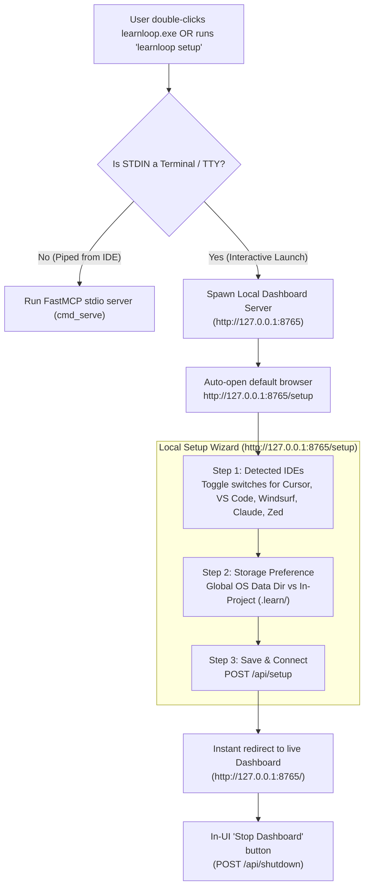

# Implementation Plan: Browser-Based GUI Setup Wizard & Smart Launch Detection

## Overview
This plan introduces a seamless, zero-friction GUI onboarding experience for Windows and desktop developers. When a user double-clicks `learnloop.exe`, instead of a blank console appearing and closing, LearnLoop automatically launches a sleek, local web-based setup wizard in their default browser. When spawned by an AI coding IDE (Cursor, VS Code, Windsurf), it continues to silently serve the Model Context Protocol over stdio pipes.

---

## Architecture Diagram

---

## Detailed Task List (TODOs)

### Phase 1: Smart Launch Detection in CLI
- [x] **Task 1.1: Add Interactive Launch Detection in `src/learnloop/cli.py`**
  - In `main()` when no arguments are provided (`args.cmd is None`):
    - Check `sys.stdin.isatty()`:
      - If `isatty()` is `True` (user launched from Explorer or terminal): launch setup server and open browser.
      - If `isatty()` is `False` (IDE attached via pipe): launch standard `cmd_serve()`.
- [x] **Task 1.2: Add Explicit `learnloop setup` Subcommand**
  - Add `setup` command to CLI argument parser:
    - Options: `--port` (default 8765), `--no-browser` (prevent auto-opening if headless).

### Phase 2: Setup Wizard Endpoints & Web UI
- [x] **Task 2.1: Implement `GET /setup` in `src/learnloop/dashboard/server.py`**
  - Serve a clean HTML page using LearnLoop's dark-mode design system.
  - Scan for installed IDEs locally and render them with active toggle switches.
  - Provide selection for Database location:
    - Recommended: Global user data (`%LOCALAPPDATA%\learnloop\learnloop.db`).
    - In-Project: Current repository folder (`.learn/learnloop.db`).
- [x] **Task 2.2: Implement `POST /api/setup` in `src/learnloop/dashboard/server.py`**
  - Receive JSON payload: `{ "ides": ["cursor", "vscode", ...], "storage": "global" | "in_repo", "repo_path": "..." }`.
  - Invoke `LearnLoopIntegrator` to configure selected IDEs and generate rules (`AGENTS.md`, `.cursorrules`, `.windsurfrules`).
  - Initialize the SQLite database and seed taxonomy.
  - Return `{ "status": "ok", "redirect": "/" }`.
- [x] **Task 2.3: Implement `POST /api/shutdown` Graceful Server Termination**
  - Create endpoint to cleanly shut down `ThreadingHTTPServer` from a background thread.
  - Add "Stop Dashboard" button in the dashboard UI header.

### Phase 3: CSS Styles & Micro-Animations
- [x] **Task 3.1: Update `src/learnloop/dashboard/static/app.css`**
  - Add styling for the 3-step indicator, toggle switches, badge indicators for detected IDEs, and celebration checkmark.

### Phase 4: Verification & Binary Build
- [x] **Task 4.1: Automated Tests in `tests/test_dashboard_server.py`**
  - Test `GET /setup` returns 200 with HTML form.
  - Test `POST /api/setup` executes integration and responds with 200.
  - Test `POST /api/shutdown` initiates clean termination.
  - Test that all existing tests remain green.
- [x] **Task 4.2: Rebuild Standalone Binary**
  - Run `scripts/build_binary.py` to create the updated `dist/learnloop.exe`.
  - Test launching the binary to verify the setup wizard.
